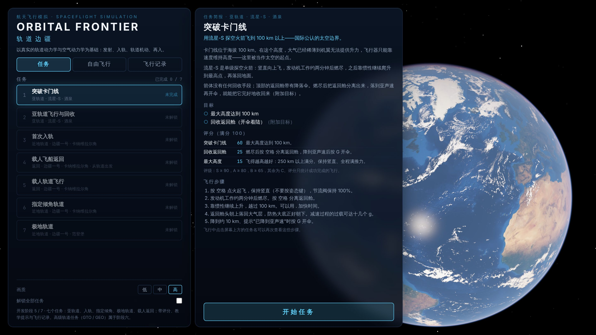
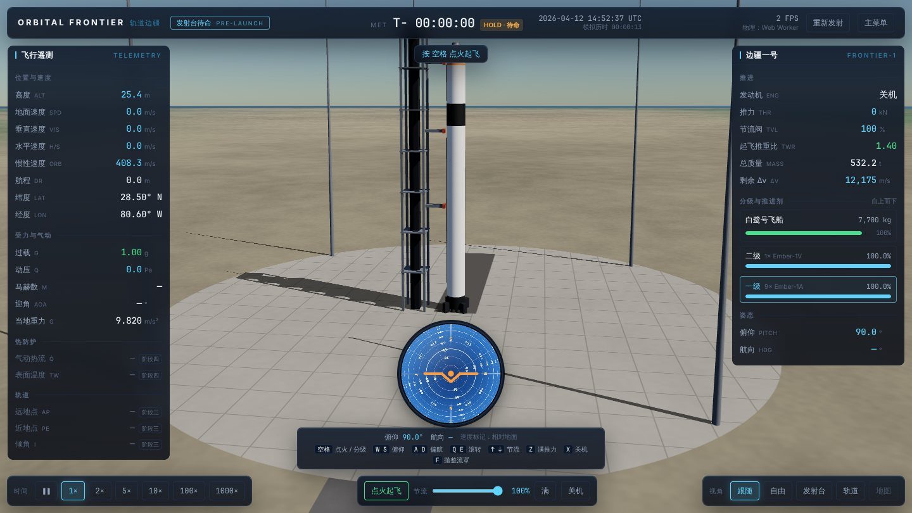
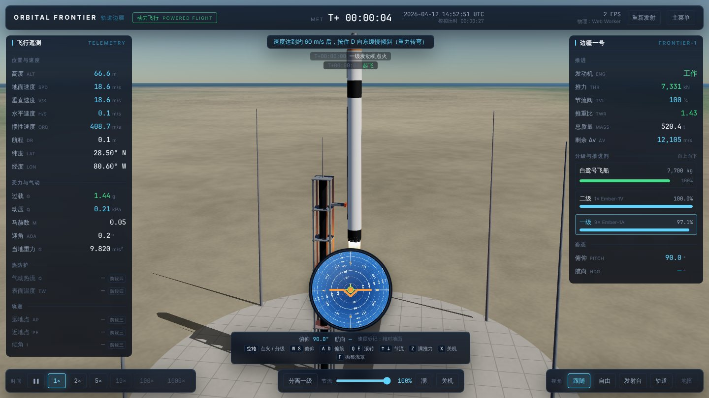

# Orbital Frontier · 轨道边疆

一款运行在浏览器里的火箭发射与轨道飞行模拟游戏。目标是以真实的轨道动力学、空气动力学和简化热物理为基础，
让玩家从地球表面发射火箭，完成亚轨道、近地轨道、极地轨道、地球同步轨道与再入返回任务。

> **当前状态：开发阶段 2 / 7 已完成（火箭基础物理）。**
> 现在可以点火起飞、用键盘控制姿态与节流、逐级分离、抛整流罩，把火箭飞进近地轨道。
> 飞行轨迹完全由物理计算决定（引力 + 推力 + 气动阻力，RK4 积分）。
> **尚未实现**：轨道参数显示与轨道地图（阶段三）、气动加热与降落伞（阶段四）、任务系统（阶段五）。
> 各功能的真实完成情况见 [ROADMAP.md](./ROADMAP.md)。



| 发射台 | 起飞 | 重力转弯 |
| --- | --- | --- |
|  |  |  |

| 一二级分离后（115 km） | 轨道视角 |
| --- | --- |
|  |  |

## 已经实现的内容

**物理与模拟**（纯 TypeScript，不依赖 React / Three.js，可独立测试）

- 参考系：ECI 地心惯性系、ECEF 地固系、ENU 局部水平系、机体系及其转换
- 时间与星历：格林尼治恒星时、太阳方向（真实的昼夜与晨昏线）
- 二体引力；标准大气 USSA76（0–1000 km）
- 推进：推力与比冲随环境压力变化，推进剂消耗，最小节流
- 气动阻力：马赫数修正 + 迎角相关的有效阻力面积，使用相对旋转大气的速度
- 自由飞行动力学：RK4 固定步长积分；推进剂步内耗尽与接地时刻的精确事件检测
- 简化姿态模型：角速度指令的一阶响应，松手后保持姿态（不含力矩与气动稳定性）
- 分级与抛整流罩：动量守恒；被抛掉的箭体作为独立弹道物体继续模拟
- 时间倍率 1×–1000×，在发动机工作、操纵、稠密大气内自动受限
- 物理运行在 Web Worker 中，渲染在快照之间插值

**飞行器**：三型数据驱动的火箭——质量、质心、推重比、Δv、三维模型都由同一份参数生成

| 火箭 | 构型 | 脚本驾驶测试中的表现 |
| --- | --- | --- |
| 流星-S | 单级 + 返回舱 | 垂直发射弹道顶点约 286 km |
| 边疆一号 | 两级 + 载人飞船 | 进入约 186×203 km 轨道，二级剩余约 13 t 推进剂 |
| 天顶三号 | 三级 + 整流罩 + 卫星 | 入轨后上面级剩余约 5 km/s 的 Δv |

**渲染**：解析射线求交的地球（影像、云、昼夜、大气散射）、浮动原点、程序化火箭与发射场、
由推力和环境压力驱动的尾焰、分离的箭体与整流罩、四种摄像机

**界面**：主菜单、飞行仪表（高度/速度/过载/动压/马赫数/推力/Δv…）、导航球、节流阀与分级控制、
操作提示、事件记录、飞行结果面板、本地存档（所选火箭、发射场、画质）

**测试**：262 项单元测试（含三型火箭从发射台到入轨的完整飞行）+ 14 项浏览器端到端测试

## 运行

需要 Node.js ≥ 20.19。

```bash
npm install
```

```bash
npm run dev
```

然后在浏览器中打开终端显示的地址（默认 `http://localhost:5173`）。需要支持 WebGL 2 的现代桌面浏览器
（Chrome、Edge、Firefox；Safari 16+ 理论上可用但尚未实测）。

### 其他命令

| 命令 | 作用 |
| --- | --- |
| `npm run build` | 类型检查并构建生产版本到 `dist/` |
| `npm run preview` | 本地预览生产构建 |
| `npm run typecheck` | 仅类型检查 |
| `npm run lint` | ESLint（含"物理层不得依赖渲染/UI 层"的架构约束） |
| `npm test` | 单元测试（Vitest） |
| `npm run test:e2e` | 端到端测试（Playwright，自动构建并启动预览服务器） |
| `npm run check` | 类型检查 + lint + 单元测试 |

首次运行端到端测试前需要安装浏览器：

```bash
npx playwright install chromium
```

### 部署

`npm run build` 的产物是纯静态文件，使用相对路径（`base: './'`），可直接部署到 Vercel、Netlify、
GitHub Pages 或任何静态托管服务，无需后端。

## 操作

**主菜单**：选择火箭与发射场，点击「进入发射台」。拖动画面可以旋转地球。

**飞行**

| 按键 | 功能 |
| --- | --- |
| `空格` | 飞行序列的下一步：点火起飞 → 分离当前级并点燃下一级 → 飞船发动机点火 |
| `W` `S` | 俯仰（发射台上：`W` 向北倾斜，`S` 向南） |
| `A` `D` | 偏航（发射台上：`D` 向东倾斜，`A` 向西） |
| `Q` `E` | 滚转 |
| `↑` `↓` | 增大 / 减小节流；`Z` 满推力；`X` 关机 |
| `F` | 抛整流罩 |
| `P` | 暂停 / 继续 |
| `,` `.` | 降低 / 提高时间倍率 |
| `1` `2` `3` `4` / `C` | 跟随 / 自由 / 发射台 / 轨道视角，或循环切换 |
| 鼠标拖动 / 滚轮 | 旋转视角 / 缩放 |

姿态键按住生效，松开后火箭保持当前姿态。节流阀、分级、抛罩也可以用底部的按钮操作。

### 第一次入轨（边疆一号，从卡纳维拉尔角向东发射）

1. `空格` 点火起飞，保持竖直上升。
2. 速度到约 60 m/s 时按住 `D`，把俯仰角压到 85° 左右后松开，让火箭自己慢慢倒向东方（重力转弯）。
   在稠密大气里尽量让头部贴着速度方向（导航球上的黄绿色顺行标记）。
3. 约 2 分 32 秒一级推进剂耗尽，按 `空格` 分离并点燃二级。
4. 二级工作时把俯仰角逐步压到 0–15°，让高度稳定在 200 km 左右、水平速度持续增加。
5. 惯性速度达到约 7.8 km/s 且垂直速度接近 0 时按 `X` 关机——你已经在轨道上了。

轨道的近地点/远地点目前还没有仪表显示（阶段三）；可以用"高度不再下降"来判断是否入轨。

## 项目结构

```
src/
  game/                 物理与模拟（纯 TypeScript，不依赖 React / Three）
    physics/              常量、数学、参考系、引力、星历、大气、气动、推进、积分、姿态
    vehicles/             飞行器类型定义、性能分析、构型相关计算
    simulation/           模拟器、固定步长时钟、消息协议、快照插值、测试用上升驾驶员
    telemetry/            遥测量推导
  data/                 游戏内容数据：火箭目录、发射场
  workers/              物理线程入口与主线程客户端
  stores/               Zustand 状态与模拟运行时（连接物理线程、UI、渲染）
  rendering/            三维渲染（React Three Fiber）
    core/                 渲染空间转换、每帧状态、帧驱动
    earth/                行星着色器、视觉大气模型、贴图
    launchpad/            发射场地面与发射工位
    rockets/              程序化火箭模型、分离体、尾焰
    sky/                  星空、光照
    cameras/              摄像机位姿计算与控制
  components/           DOM 界面：主菜单、飞行 HUD（含导航球）、通用控件
  app/                  应用根组件
  utils/                显示格式化
tests/e2e/              Playwright 端到端测试
docs/screenshots/       文档配图
```

单元测试与被测模块放在一起（`*.test.ts`）。

## 文档

| 文档 | 内容 |
| --- | --- |
| [ARCHITECTURE.md](./ARCHITECTURE.md) | 系统分层、模块依赖、线程模型、数据流、渲染管线 |
| [PHYSICS.md](./PHYSICS.md) | 物理模型、公式、参数、适用范围与精度限制 |
| [GAME_DESIGN.md](./GAME_DESIGN.md) | 玩法、任务、操作与界面设计 |
| [ROADMAP.md](./ROADMAP.md) | 七个开发阶段与各功能的实现状态 |
| [TASKS.md](./TASKS.md) | 当前任务、已完成任务与待办 |
| [TESTING.md](./TESTING.md) | 测试方法、实测结果与已知问题 |

## 技术栈

React 19 · TypeScript 6（strict）· Vite 8 · Three.js + React Three Fiber + Drei · Zustand · Tailwind CSS 4 ·
Vitest · Playwright

## 素材来源

- 地球影像（白昼、夜间灯光、水域掩膜、云层）：源自 NASA Blue Marble / Black Marble 系列影像
  （NASA Earth Observatory，公有领域），取自 MIT 许可的
  [three-globe](https://github.com/vasturiano/three-globe) 示例素材，并转换了格式与通道。
- 火箭、发动机、飞船均为本项目原创的虚构型号；发射场使用真实地理位置的近似经纬度。

## 许可

[Apache License 2.0](./LICENSE)
