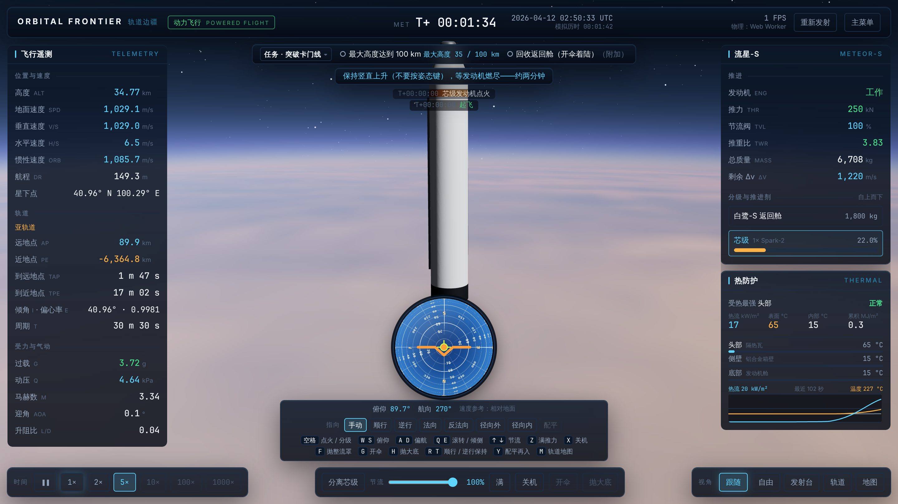
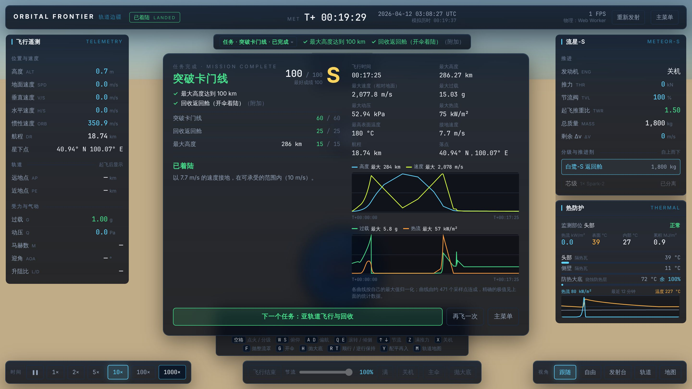
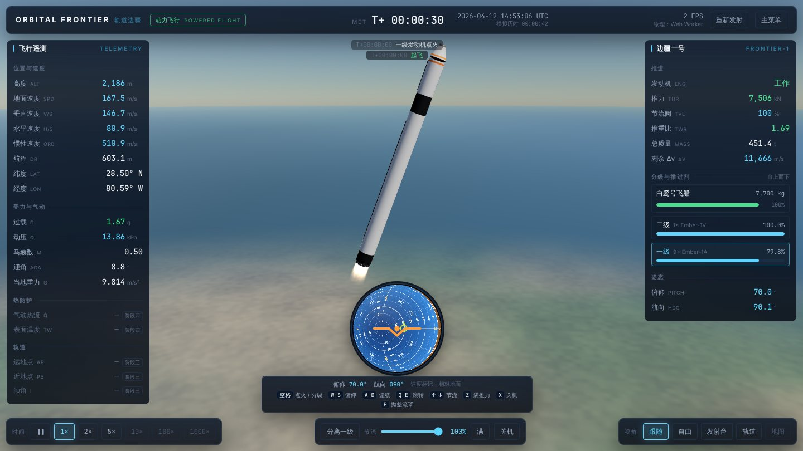
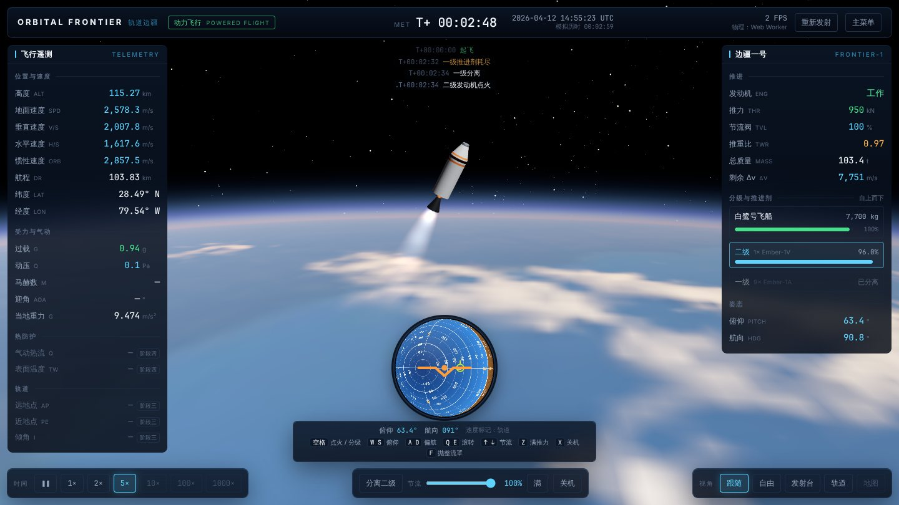
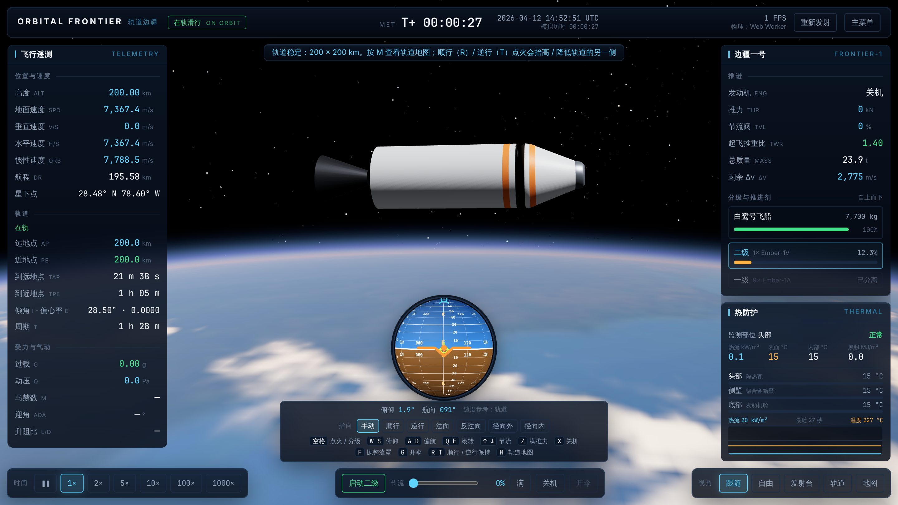
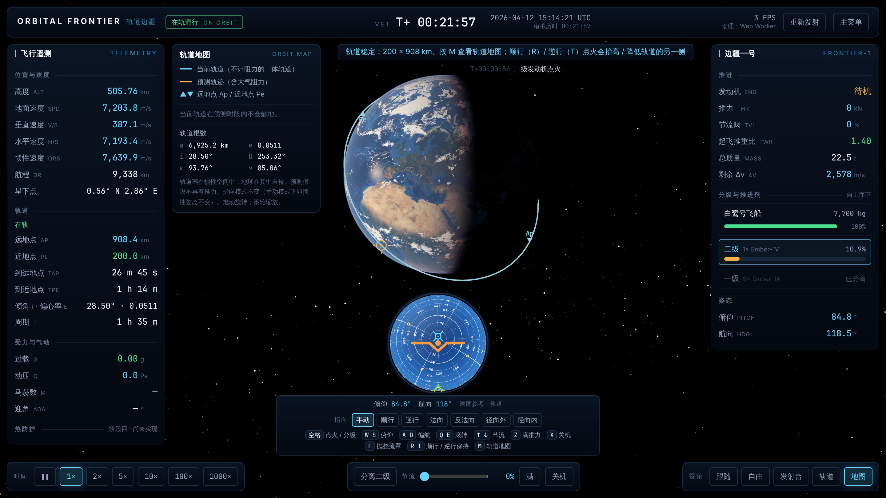
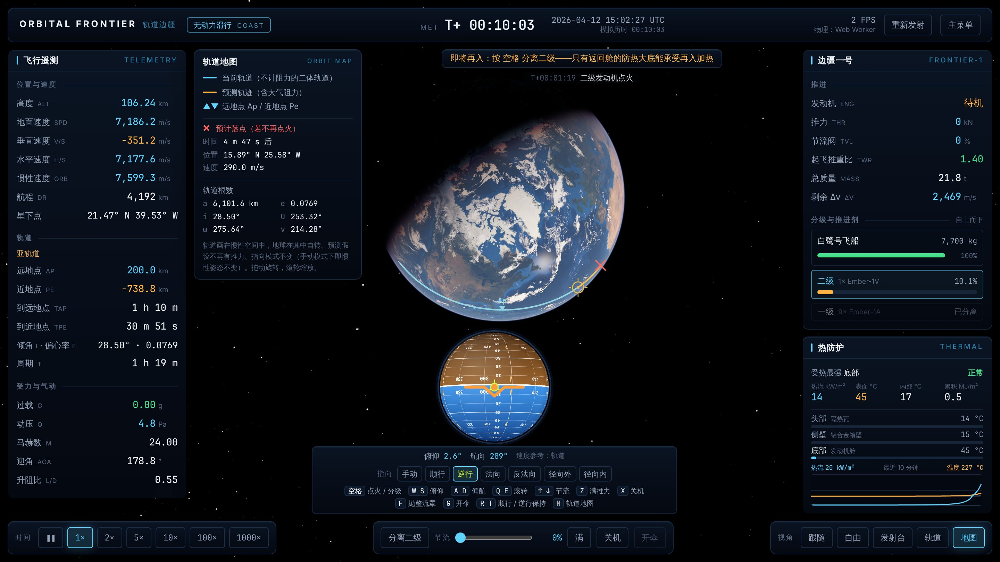
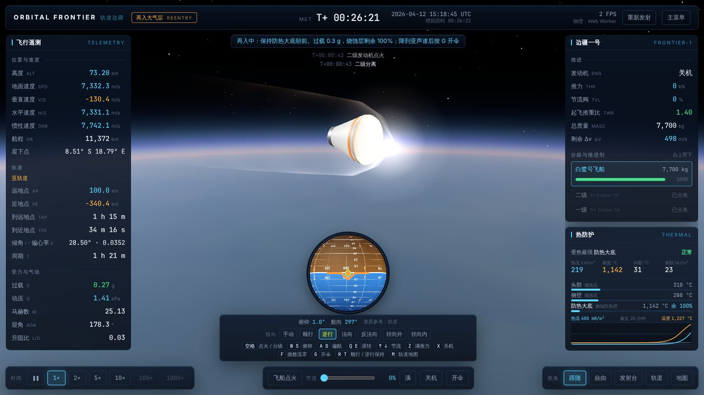
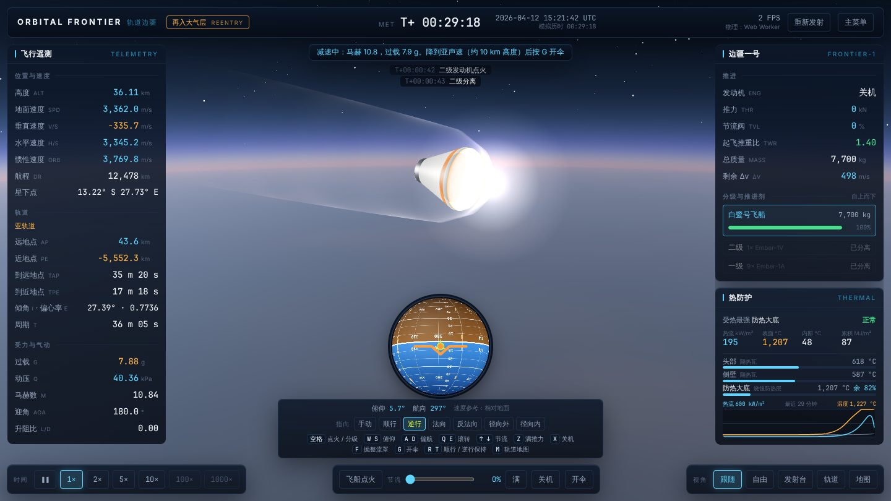
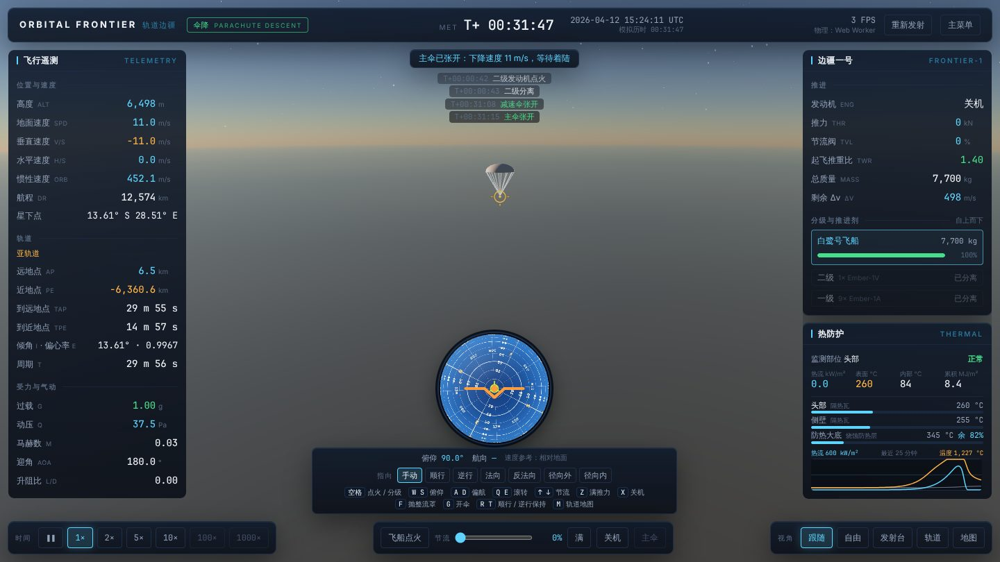

# Orbital Frontier · 轨道边疆

> 阶段七进行中（2026-11-17）：火箭设计与存档第一组已验收，824项单元测试及11项相关浏览器测试通过。见[第一组报告](docs/阶段七第一组报告.md)与[实施计划](docs/阶段七实施计划.md)。

一款运行在浏览器里的火箭发射与轨道飞行模拟游戏。目标是以真实的轨道动力学、空气动力学和简化热物理为基础，
让玩家从地球表面发射火箭，完成亚轨道、近地轨道、极地轨道、地球同步轨道与再入返回任务。

> **当前状态：开发阶段 7 / 7 进行中（火箭设计与存档）。**
> 现在有一个完整的游戏循环：选择任务 → 发射 → 完成目标 → 评分 → 存档 → 解锁下一个任务。
> 八个任务：突破卡门线、亚轨道飞行与回收、首次入轨、载人飞船返回、载人轨道飞行、指定倾角轨道、极地轨道、同步通信卫星部署。
> 飞行轨迹完全由物理计算决定（引力 + 推力 + 气动力，RK4 积分；安全真空滑行使用开普勒传播）；再入时的气动加热、防热层烧蚀、过载与动压都由物理模型计算，
> 任务的成败与评分只读取这些物理结果。
> **阶段七本组已接入**：模块化火箭设计、图纸备份、持久化遥测回看；自动驾驶、专家物理和中途续飞尚未实现。
> 各功能的真实完成情况见 [ROADMAP.md](./ROADMAP.md)。


| 任务飞行：屏幕上方是任务目标与提示 | 任务结果：评级、各项得分与飞行记录曲线 |
| --- | --- |
|  |  |

| 发射台 | 起飞 | 重力转弯 |
| --- | --- | --- |
|  |  |  |

| 一二级分离后 | 在 200 km 轨道上 |
| --- | --- |
|  |  |

| 轨道地图：200 × 912 km 椭圆轨道 | 轨道地图：逆行点火后的预测轨迹与预计落点 |
| --- | --- |
|  |  |

| 再入（73 km）：防热大底朝前，等离子体辉光 | 减速段（36 km）：过载约 8 g，大底余温未退 | 主伞张开（镜头已拉远） |
| --- | --- | --- |
|  |  |  |

截图来自没有 GPU 的开发环境（软件渲染），画面内容与实际一致，右上角的帧率不具代表性。

## 已经实现的内容

**物理与模拟**（纯 TypeScript，不依赖 React / Three.js，可独立测试）

- 参考系：ECI 地心惯性系、ECEF 地固系、ENU 局部水平系、机体系及其转换
- 时间与星历：格林尼治恒星时、太阳方向（真实的昼夜与晨昏线）
- 二体引力；标准大气 USSA76（0–1000 km）
- 推进：推力与比冲随环境压力变化，推进剂消耗，最小节流；并联助推器（与芯级同时工作、各自耗尽、分离成独立的分离体）
- 气动力：机体轴向力 + 法向力（阻力与升力），马赫数修正，使用相对旋转大气的速度；返回舱带迎角时升阻比约 0.27
- 返回舱的配平迎角：由质心的横向偏移按牛顿流球冠模型算出（联盟号返回舱约 17°）；"配平再入"模式保持这个迎角，倾侧角决定升力的方向
- 气动加热：Sutton–Graves 驻点热流，含稀薄流上限与热壁修正；上升段与再入段用同一套公式
- 热防护：每个热区（头部 / 侧壁 / 底部）一个两节点集总热容模型——对流、辐射、向内传导、烧蚀
- 失效：表面过热、防热层烧穿、结构热透、过载、动压、带迎角的横向气动载荷——任何一项超限即空中解体
- 降落伞：减速伞 + 主伞，开伞条件超限会撕毁；返回舱以约 8 m/s 着陆
- 抛防热大底：减去大底的质量（落得更慢），露出没有防热能力的舱底——抛早了会被烧毁
- 自由飞行动力学：RK4 固定步长积分；推进剂步内耗尽与接地时刻的精确事件检测
- 简化姿态模型：角速度指令的一阶响应，松手后保持姿态（不含力矩与气动稳定性）
- 自动指向：顺行 / 逆行 / 法向 / 反法向 / 径向 / 配平再入（只保持姿态，不替玩家点火）
- 分级与抛整流罩：动量守恒；被抛掉的箭体作为独立弹道物体继续模拟
- 轨道根数（椭圆 / 抛物线 / 双曲线）、近/远地点、周期、到拱点的时间
- 开普勒解析传播（通用变量法），并据此为 RK4 定义了二体问题的数值误差标准：
  近地轨道一圈的位置误差上限 1 mm（实测约 10⁻⁶ m）
- 轨迹预测：在状态副本上传播（含大气阻力），给出再入轨迹与落点
- 时间倍率 1×–100000×（安全真空区间），在发动机工作、操纵、稠密大气内自动受限
- 物理运行在 Web Worker 中，渲染在快照之间插值

- 发射方位角与轨道倾角的关系（含地球自转修正）：卡纳维拉尔角 → 51.6° 要飞向 043°，范登堡 → 极地轨道要飞向 183°

**任务系统**（纯逻辑，只读遥测、统计与飞行结果）

- 八个任务，五类目标（新增同步轨道与卫星部署）：达到高度、入轨（关机后连续 10 秒满足近/远地点与倾角要求）、返回舱安全着陆；附加目标
- 评分：每个任务 3–5 项（轨道圆度、倾角精度、推进剂余量、乘员过载、防热大底余量、着陆速度、航程……），满分 100，评级 S / A / B / C / F
- 任务简报、飞行步骤、随任务变化的操作提示；任务进度、解锁与飞行日志保存在浏览器里
- 飞行记录仪：高度、速度、过载、热流随时间的曲线

**飞行器**：三型真实火箭——质量、质心、推重比、Δv、三维模型都由同一份参数生成。
发动机推力、比冲、节流范围与各级质量取自英文维基百科（及其引用的用户手册），查不到的量在 `src/data/vehicles.ts` 里标为"估算"，详见 [PHYSICS.md](./PHYSICS.md) 第 27 节。

| 火箭 | 构型 | 自动化测试中的表现 |
| --- | --- | --- |
| 水星-红石 | 单级（A-7，定推力）+ 水星飞船 | 竖直发射弹道顶点约 297 km；300 m/s 时向东倾斜 15°：最高 209 km、落点 528 km（自由 7 号实测 187 km、487 km）；主伞下约 9.1 m/s 溅落 |
| 联盟-2.1a | 4 个并联助推器 + 芯级 + 第三级 + 联盟 MS | 手动流程进入约 150×230 km 轨道，剩余 Δv 只有 190–230 m/s；配平再入约 5.3 g，弹道再入约 8.2 g |
| 宇宙神 V 401 | RD-180 芯级（可节流 47–100%）+ 半人马座 + 整流罩 + 卫星 | 从范登堡进入极地轨道；从卡纳维拉尔角完成 GTO → GEO 卫星部署 |

**渲染**：解析射线求交的地球（影像、云、昼夜、大气散射）、浮动原点、程序化火箭与发射场、
由推力和环境压力驱动的尾焰、分离的箭体与整流罩、五种摄像机、
轨道地图（当前轨道、预测轨迹、远/近地点、预计落点，被地球正确遮挡）、
由热流驱动的再入辉光、随表面温度发光的防热大底、降落伞

**界面**：主菜单（任务列表与简报、自由飞行、飞行记录）、飞行仪表（高度/速度/过载/动压/马赫数/推力/Δv、轨道参数）、
任务条（目标与当前读数）、热防护监控面板（热流、表面/内部温度、热载荷、烧蚀层余量、风险、时间曲线）、导航球与指向模式、
节流阀、分级、开伞与抛大底控制、覆盖发射到着陆全程的操作提示、事件记录、
结果面板（评级与各项得分、失败原因、统计数据、飞行记录曲线）、
本地存档（任务进度、飞行日志、所选火箭、发射场、画质）

**阶段五历史验收**：569 项单元测试（含从发射台到入轨的完整飞行、轨道机动、各种再入条件下的结果、七个任务的成功与失败路径）
+ 26 项浏览器端到端测试（含从主菜单选任务到拿到评分的完整循环）

## 运行

需要 Node.js ≥ 20.19。

```bash
npm install
```

```bash
npm run dev
```

然后在浏览器中打开终端显示的地址（默认 `http://localhost:5173`）。需要支持 WebGL 2 的现代桌面浏览器
（Chrome、Edge、Firefox；Safari 16+ 理论上可用但尚未实测）。

### 其他命令

| 命令 | 作用 |
| --- | --- |
| `npm run build` | 类型检查并构建生产版本到 `dist/` |
| `npm run preview` | 本地预览生产构建 |
| `npm run typecheck` | 仅类型检查 |
| `npm run lint` | ESLint（含"物理层不得依赖渲染/UI 层"的架构约束） |
| `npm test` | 单元测试（Vitest） |
| `npm run test:e2e` | 端到端测试（Playwright，自动构建并启动预览服务器） |
| `npm run check` | 类型检查 + lint + 单元测试 |

首次运行端到端测试前需要安装浏览器：

```bash
npx playwright install chromium
```

### 部署

`npm run build` 的产物是纯静态文件，使用相对路径（`base: './'`），可直接部署到 Vercel、Netlify、
GitHub Pages 或任何静态托管服务，无需后端。
仓库里的 `.github/workflows/deploy.yml` 会在推送 `feature/001` 分支时自动构建并发布到 GitHub Pages。

## 操作

**语言 / Language**：主菜单顶部可切换「简体中文 / English」，菜单、任务简报、飞行仪表、操作提示、结果与飞行记录会使用所选语言。选择保存在当前浏览器，刷新后仍有效；默认简体中文，不改变飞行、任务进度或物理参数。阶段六、七新增功能按当前要求使用中文，旧七任务与原界面继续保留英文切换。

**主菜单**有四个页签：

- **任务**：左边是任务列表（未解锁 / 未完成 / 评级），右边是所选任务的简报——背景、目标、评分项、飞行步骤。
  点击「开始任务」。任务按顺序解锁；页面底部有"解锁全部任务"开关。
- **自由飞行**：自己选择火箭、发射场与出发点（发射台，或直接从 200 km 近地轨道开始），没有目标与评分。
- **火箭设计**：完整模块组装、性能预览、图纸保存与备份。
- **飞行记录**：最近的飞行与成绩，展开已保存的遥测曲线回看。

拖动画面可以旋转地球。任务飞行时屏幕上方显示各目标的完成情况；点击任务名可以再看一遍飞行步骤。
飞行结束（或任务有了结论）时出现结果面板：评级、各项得分、统计数据与飞行记录曲线。

**飞行**

| 按键 | 功能 |
| --- | --- |
| `空格` | 飞行序列的下一步：点火起飞 → 分离当前级并点燃下一级 → 飞船发动机点火（从轨道出发时先启动上面级） |
| `W` `S` | 俯仰（发射台上：`W` 向北倾斜，`S` 向南） |
| `A` `D` | 偏航（发射台上：`D` 向东倾斜，`A` 向西） |
| `Q` `E` | 滚转；配平再入时改变倾侧角（升力的方向） |
| `↑` `↓` | 增大 / 减小节流；`Z` 满推力；`X` 关机 |
| `R` `T` | 顺行保持 / 逆行保持（再按一次回到手动） |
| `Y` | 配平再入：防热大底朝前并保持配平迎角，产生升力（返回舱与推进级分离之后） |
| `F` | 抛整流罩 |
| `G` | 开伞（返回舱与推进级分离之后） |
| `H` | 抛防热大底（主伞张开之后） |
| `M` | 打开 / 关闭轨道地图 |
| `P` | 暂停 / 继续 |
| `,` `.` | 降低 / 提高时间倍率 |
| `1` `2` `3` `4` `5` / `C` | 跟随 / 自由 / 发射台 / 轨道 / 地图视角，或循环切换 |
| 鼠标拖动 / 滚轮 | 旋转视角 / 缩放 |

姿态键按住生效，松开后火箭保持当前姿态。节流阀、分级、抛罩、其余指向模式（法向、径向）用屏幕上的按钮操作。
屏幕上方会根据飞行状态给出一句操作提示。

### 第一次入轨（联盟-2.1a，从拜科努尔向东发射）

1. `空格` 点火起飞，保持竖直上升。四个助推器和芯级同时工作，发动机不能节流。
2. 速度到约 60 m/s 时按住 `D`，把俯仰读数压到 87–88°（向东倾斜 2–3°）后松开。
3. 等大约 5 秒，按 `R` 开启**顺行保持**：火箭会沿着速度方向飞行，自动完成大气层内的重力转弯。
4. 约 2 分钟时四个助推器烧完：按 `空格` 抛掉它们（芯级继续工作），再按 `R` 回到手动。
5. 用 `A` / `D` 调整俯仰角（每次 2–5°）来控制**垂直速度**：让它随着高度接近 200 km 逐渐降到 0。
   升得太快就把头压低，升得不够或开始下降就抬高。约 4 分 45 秒芯级烧完，按 `空格` 分离并点燃第三级。
6. 近地点超过 150 km（轨道状态显示"在轨"）时按 `X` 关机。联盟号的余量很小：第三级烧光还差一点的话，
   按 `空格` 抛掉第三级，用服务舱的主发动机补足。

这样起飞后导航球上的地平线是竖着的（箭体没有做滚转）。想让它变成水平，可以在第 3 步之后按住 `Q` 约 6 秒把箭体滚转 90°，
此后第 5 步改用 `S` 抬头、`W` 低头。

这套流程经过自动化测试验证：一个只读仪表、每隔两秒调整一次俯仰角的测试驾驶员按它飞行，转弯角 2–3° 都能入轨。
它**没有经过真人试玩**验证。宇宙神 V 401 的起飞推重比只有约 1.2：要等到约 100 m/s 再倾斜约 1–1.5°，
倾斜早了、多了会因轨迹过低在稠密大气里动压过大而解体；芯级末段用 `↓` 收节流，把过载压在 5 g 以下。

### 在轨道上

主菜单把出发点选为「近地轨道 200 km」可以跳过上升段，直接练习：

- `M` 打开轨道地图。青色是当前轨道，▲ / ▼ 是远地点 / 近地点。
- **抬高轨道**：按 `R`（顺行保持），`空格` 启动发动机，`Z` 点火（联盟号服务舱的 KTDU-80 只有 2.95 kN，要烧几十秒），`X` 关机。远地点升高了，近地点没变——
  顺行加速抬高的是轨道**对面**的那一侧。
- **圆化**：滑行到远地点附近（用 `.` 加速时间，看"到远地点"读数），再顺行点火，把近地点也抬上来。
- **离轨**：按 `T`（逆行保持），等箭体调头后点火，直到近地点降到地面以下。地图上出现橙色的预测轨迹和红色的预计落点。

### 返回地球（联盟 MS 飞船）

1. 在轨道上按 `T` 逆行保持，调头后按 `空格` 启动服务舱主发动机、`Z` 点火，把近地点降到 0–50 km，`X` 关机。
   KTDU-80 主发动机推力只有 2.95 kN，这次点火要烧一两分钟（可以用 5× 时间倍率）。
2. 按 `空格` **抛掉服务舱与轨道舱**。它们没有任何防热设计，带着它们再入会在约 70 km 高度烧毁。
3. 让防热大底朝前，有两种方式（舱顶朝前或侧着进入大气层都会烧毁）：
   - 保持**逆行保持**（`T`）：大底正对来流，没有升力——弹道式再入，峰值过载约 8 g；
   - 按 `Y` 改为**配平再入**：返回舱的质心偏离轴线（游戏中取估算值 5.6 cm），再入时配平在约 17° 迎角上，升阻比约 0.27。
     升力向上（倾侧 0°）时过载约 5 g，但飞得更远、受热更久。
     `Q` / `E` 改变倾侧角：向左 / 向右倾侧使落点横向偏移；倾侧超过约 100° 升力向下，过载会超过结构限值。
4. 用 `.` 加速时间滑行到大气层。再入开始后时间倍率自动限制在 10×；右侧"热防护"面板显示热流、温度与烧蚀层余量。
5. 降到约 10 km、提示"已降到亚声速"时按 `G` 开伞：先是减速伞，之后主伞自动打开，以约 7 m/s 着陆。
   超声速时开伞会把伞撕毁；不开伞则以一百多米每秒撞击地面。真实的联盟号在离地 1 m 时点燃软着陆发动机，游戏里没有建模。
6. 主伞张开后可以按 `H` **抛掉防热大底**：返回舱减轻约 300 kg，着陆速度由约 7.0 降到 6.7 m/s。
   大底只能在再入结束后抛——抛早了，露出来的舱底结构没有任何防热能力，会在高层大气里烧毁。

离轨点火越猛，再入角越陡、过载越大（弹道式超过约 14 g 飞船会解体）；点火不足则落得更远、受热更久。

水星飞船同样有降落伞：关机后按 `空格` 分离，下落到亚声速后按 `G`。它的质心在对称轴上，是弹道式返回舱，没有配平再入模式。

## 项目结构

```
src/
  game/                 物理与模拟（纯 TypeScript，不依赖 React / Three）
    physics/              常量、数学、参考系、引力、星历、大气、气动力与配平、推进、积分、姿态与指向、轨道与发射方位、气动加热与热防护
    vehicles/             飞行器类型定义、性能分析、构型相关计算
    simulation/           模拟器、固定步长时钟、消息协议、快照插值、轨迹预测、起始条件、测试用驾驶员
    telemetry/            遥测量推导、热历程、飞行记录仪
    missions/             任务判定、评分、进度与解锁、飞行日志、发射引导（只读遥测的纯逻辑）
  data/                 游戏内容数据：火箭目录、发射场、表面材料、任务目录
  workers/              物理线程入口与主线程客户端
  stores/               Zustand 状态、生涯存档与模拟运行时（连接物理线程、任务判定、UI、渲染）
  rendering/            三维渲染（React Three Fiber）
    core/                 渲染空间转换、每帧状态、帧驱动
    earth/                行星着色器、视觉大气模型、贴图
    launchpad/            发射场地面与发射工位
    rockets/              程序化火箭模型、分离体、尾焰
    sky/                  星空、光照
    cameras/              摄像机位姿计算与控制
    orbital-map/          轨道地图：轨道线、预测轨迹、拱点与落点标记
    effects/              再入辉光、降落伞，以及"物理量 → 外观"的映射函数
  components/           DOM 界面：主菜单（任务、自由飞行、飞行记录）、飞行 HUD（任务条、导航球、指向模式、热防护面板、地图图例、操作提示、结果面板）、通用控件
  app/                  应用根组件
  utils/                显示格式化
tests/e2e/              Playwright 端到端测试
docs/screenshots/       文档配图
```

单元测试与被测模块放在一起（`*.test.ts`）。

## 文档

| 文档 | 内容 |
| --- | --- |
| [ARCHITECTURE.md](./ARCHITECTURE.md) | 系统分层、模块依赖、线程模型、数据流、渲染管线 |
| [PHYSICS.md](./PHYSICS.md) | 物理模型、公式、参数、适用范围与精度限制 |
| [GAME_DESIGN.md](./GAME_DESIGN.md) | 玩法、任务、操作与界面设计 |
| [ROADMAP.md](./ROADMAP.md) | 七个开发阶段与各功能的实现状态 |
| [TASKS.md](./TASKS.md) | 当前任务、已完成任务与待办 |
| [TESTING.md](./TESTING.md) | 测试方法、实测结果与已知问题 |

## 技术栈

React 19 · TypeScript 6（strict）· Vite 8 · Three.js + React Three Fiber + Drei · Zustand · Tailwind CSS 4 ·
Vitest · Playwright

## 素材来源

- 地球影像（白昼、夜间灯光、水域掩膜、云层）：源自 NASA Blue Marble / Black Marble 系列影像
  （NASA Earth Observatory，公有领域），取自 MIT 许可的
  [three-globe](https://github.com/vasturiano/three-globe) 示例素材，并转换了格式与通道。
- 火箭、发动机、飞船均为本项目原创的虚构型号；发射场使用真实地理位置的近似经纬度。

## 许可

[Apache License 2.0](./LICENSE)

## 高级轨道任务：同步通信卫星

完成“首次入轨”后解锁，或在菜单启用“解锁全部任务”。使用宇宙神 V 401、卡纳维拉尔角。停泊轨道倾角约 28.5°，要在远地点和圆化一起消掉。卫星（1.8 t，虚构）没有发动机，质量按宇宙神 V 401 加半人马座能直接送入 GEO 的能力设定。

1. 约 100 m/s 时轻按 D 向东倾斜约 1°，松开，使用顺行保持。芯级末段过载超过 5 g 时按 ↓ 收节流；分级后 100 km 以上抛罩。上面级按仪表调俯仰，近地点超过150 km后关机，确认停泊轨道。
2. 按 M，展开“高级轨道”，选择“GTO 注入”。紫色是瞬时机动预览，绿色是目标参考轨道。节点也可双击青色轨道选点，或输入延时及顺行／径向／法向增量。
3. 点击“指向机动方向”，按预计燃烧时长的一半提前点火。节点附近自动降至5×；精细关机建议1×。GTO有限时长点火会有误差：剩余增量接近零而远地点仍偏低时，改顺行补推至约35793 km，再关机确认GTO。
4. 清除旧节点，选择“赤道圆化”。它在较高的赤道交点合并圆化与倾角修正。按同样方法点火，关机后核对实际轨道；可用远地点圆化、同步高度修正或自定义节点继续修正。
5. GEO要求周期误差≤120 s、偏心率≤0.002、倾角≤0.2°，且预测一个恒星日的星下点经度摆幅≤1°。关机保持10 s确认后部署，再确认部署冲量后的GEO。卫星没有发动机，部署后不能修正。

真空、关机、姿态稳定且无分离体时支持10000×和100000×；大气模型到1000 km，低轨仍逐步积分，最高1000×。
地面轨迹同时显示在地球表面与经纬度平面图，计入地球自转。平面图目前只有经纬网格，没有陆地底图。
机动只规划与指向，玩家负责点火、关机和修正。机动规划、同步卫星任务、火箭设计室与遥测回看同样支持中英文切换。

建立或修改节点时，地图自动调整取景以容纳当前轨道和机动预览，之后仍可手动拖动与缩放。

半人马座的 RL10C-1 不能节流（最低节流 100%）。精修时可在机动面板逐次点击“点火0.1秒”或“点火0.02秒”，每次之后核对剩余增量与实际周期；点火前先对准机动方向。

## 火箭设计与历史遥测（阶段七进行中）

进入“火箭设计”，选择内置模板，调整推进级的模块、数量和顺序，选择同接口载荷并命名。保存后点击“用于自由飞行”，再进入发射台。设计器实时显示质量、海平面推重比、逐级燃烧时间与理想Δv。推重比不足只警告，不会自动提高推力。最多20份图纸，可导入/导出JSON备份；任务仍使用固定内置型号。

飞行结束或离开飞行时，遥测采样与事件独立保存。进入“飞行记录”→“查看遥测曲线”，可拖动时间轴或播放回看，也可导出数据。曲线各自归一化，点间为线性估读；这不是三维回放或中途续飞。清空飞行记录会同时清空这些曲线。浏览器禁用存储、空间不足、损坏存档均有提示。
