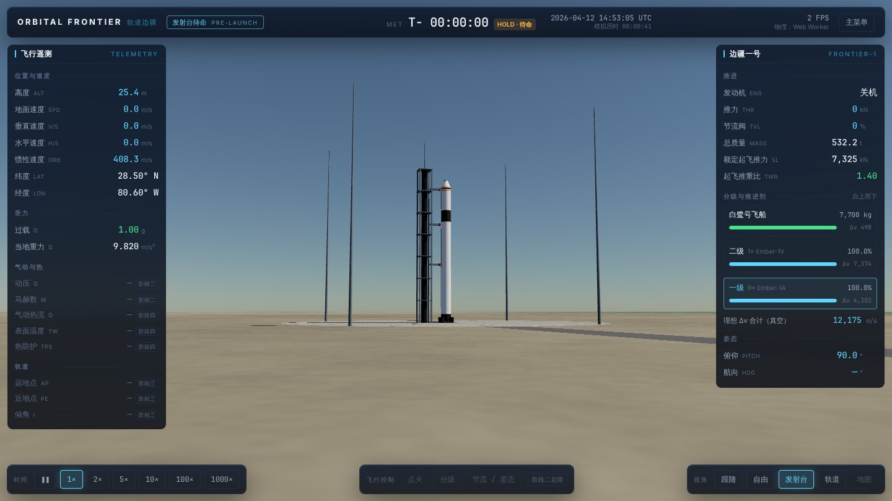
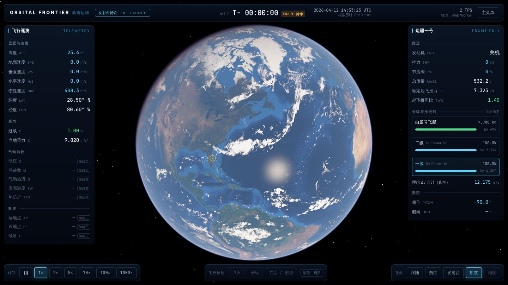

# Orbital Frontier · 轨道边疆

一款运行在浏览器里的火箭发射与轨道飞行模拟游戏。目标是以真实的轨道动力学、空气动力学和简化热物理为基础，
让玩家从地球表面发射火箭，完成亚轨道、近地轨道、极地轨道、地球同步轨道与再入返回任务。

> **当前状态：开发阶段 1 / 7 已完成（基础场景与工程架构）。**
> 现在可以看到实时渲染的三维地球、按物理参数生成的火箭与发射场、任务控制风格的飞行仪表，
> 可以切换视角与时间倍率。**发动机点火、起飞与飞行动力学尚未实现**（阶段二）。
> 各功能的真实完成情况见 [ROADMAP.md](./ROADMAP.md)。


| 跟随视角 | 发射台机位 | 轨道视角 |
| --- | --- | --- |
|  |  |  |

## 阶段一已经实现的内容

- **物理核心骨架**（纯 TypeScript，不依赖 React / Three.js，可独立测试）
  - 集中管理的物理常量、双精度向量/四元数数学库
  - 四个参考系及其转换：ECI 地心惯性系、ECEF 地固系、ENU 局部水平系、机体系
  - 格林尼治恒星时、太阳低精度星历（真实的昼夜与晨昏线）
  - 二体引力、发动机推力/流量/比冲随环境压力的变化、齐奥尔科夫斯基方程
- **数据驱动的飞行器**：多级火箭定义 → 质量、质心、推重比、逐级理想 Δv 全部由参数计算
- **模拟器**：固定步长时钟、运行在 Web Worker 中的物理线程、快照协议、渲染插值
  - 当前只有"发射台待命"状态：火箭随地球自转做圆周运动（解析解，不是占位数据）
- **三维渲染**
  - 解析射线求交的行星着色器：地表影像、云层与云影、昼夜与城市灯光、海面太阳耀斑、单次散射大气
  - 浮动原点（相机相对渲染）：从发射台 1 m 到地球同步轨道 4 万公里都没有精度抖动
  - 按火箭参数程序化生成的箭体、发射塔与发射场地面；实时阴影
  - 四种摄像机（跟随 / 自由 / 发射台 / 轨道）与平滑过渡
- **界面**：主菜单、飞行 HUD、时间倍率（暂停与 1×–1000×）、键盘快捷键、本地存档（LocalStorage）
- **测试**：158 项单元测试 + 9 项浏览器端到端测试

## 运行

需要 Node.js ≥ 20.19。

```bash
npm install
```

```bash
npm run dev
```

然后在浏览器中打开终端显示的地址（默认 `http://localhost:5173`）。需要支持 WebGL 2 的现代桌面浏览器
（Chrome、Edge、Firefox；Safari 16+ 理论上可用但尚未实测）。

### 其他命令

| 命令 | 作用 |
| --- | --- |
| `npm run build` | 类型检查并构建生产版本到 `dist/` |
| `npm run preview` | 本地预览生产构建 |
| `npm run typecheck` | 仅类型检查 |
| `npm run lint` | ESLint（含"物理层不得依赖渲染/UI 层"的架构约束） |
| `npm test` | 单元测试（Vitest） |
| `npm run test:e2e` | 端到端测试（Playwright，自动构建并启动预览服务器） |
| `npm run check` | 类型检查 + lint + 单元测试 |

首次运行端到端测试前需要安装浏览器：

```bash
npx playwright install chromium
```

### 部署

`npm run build` 的产物是纯静态文件，使用相对路径（`base: './'`），可直接部署到 Vercel、Netlify、
GitHub Pages 或任何静态托管服务，无需后端。

## 操作

**主菜单**：选择火箭与发射场，点击「进入发射台」。拖动画面可以旋转地球。

**飞行界面**

| 操作 | 说明 |
| --- | --- |
| 鼠标左键拖动 | 旋转视角 |
| 鼠标滚轮 | 拉近 / 拉远 |
| `1` `2` `3` `4` | 跟随 / 自由 / 发射台 / 轨道视角 |
| `C` | 循环切换视角 |
| `P` | 暂停 / 继续 |
| `,` `.` | 降低 / 提高时间倍率（1× 2× 5× 10× 100× 1000×） |

点火、分级、节流、姿态控制按钮目前处于禁用状态，将在阶段二启用。

## 项目结构

```
src/
  game/                 物理与模拟（纯 TypeScript，不依赖 React / Three）
    physics/              常量、数学、参考系、引力、星历、推进
    vehicles/             飞行器类型定义与性能分析
    simulation/           模拟器、固定步长时钟、消息协议、快照插值
    telemetry/            遥测量推导
  data/                 游戏内容数据：火箭目录、发射场
  workers/              物理线程入口与主线程客户端
  stores/               Zustand 状态与模拟运行时（连接物理线程、UI、渲染）
  rendering/            三维渲染（React Three Fiber）
    core/                 渲染空间转换、每帧状态、帧驱动
    earth/                行星着色器、视觉大气模型、贴图
    launchpad/            发射场地面与发射工位
    rockets/              程序化火箭模型
    sky/                  星空、光照
    cameras/              摄像机位姿计算与控制
  components/           DOM 界面：主菜单、飞行 HUD、通用控件
  app/                  应用根组件
  utils/                显示格式化
tests/e2e/              Playwright 端到端测试
docs/screenshots/       文档配图
```

单元测试与被测模块放在一起（`*.test.ts`）。

## 文档

| 文档 | 内容 |
| --- | --- |
| [ARCHITECTURE.md](./ARCHITECTURE.md) | 系统分层、模块依赖、线程模型、数据流、渲染管线 |
| [PHYSICS.md](./PHYSICS.md) | 物理模型、公式、参数、适用范围与精度限制 |
| [GAME_DESIGN.md](./GAME_DESIGN.md) | 玩法、任务、操作与界面设计 |
| [ROADMAP.md](./ROADMAP.md) | 七个开发阶段与各功能的实现状态 |
| [TASKS.md](./TASKS.md) | 当前任务、已完成任务与待办 |
| [TESTING.md](./TESTING.md) | 测试方法、实测结果与已知问题 |

## 技术栈

React 19 · TypeScript 6（strict）· Vite 8 · Three.js + React Three Fiber + Drei · Zustand · Tailwind CSS 4 ·
Vitest · Playwright

## 素材来源

- 地球影像（白昼、夜间灯光、水域掩膜、云层）：源自 NASA Blue Marble / Black Marble 系列影像
  （NASA Earth Observatory，公有领域），取自 MIT 许可的
  [three-globe](https://github.com/vasturiano/three-globe) 示例素材，并转换了格式与通道。
- 火箭、发动机、飞船均为本项目原创的虚构型号；发射场使用真实地理位置的近似经纬度。

## 许可

[Apache License 2.0](./LICENSE)
