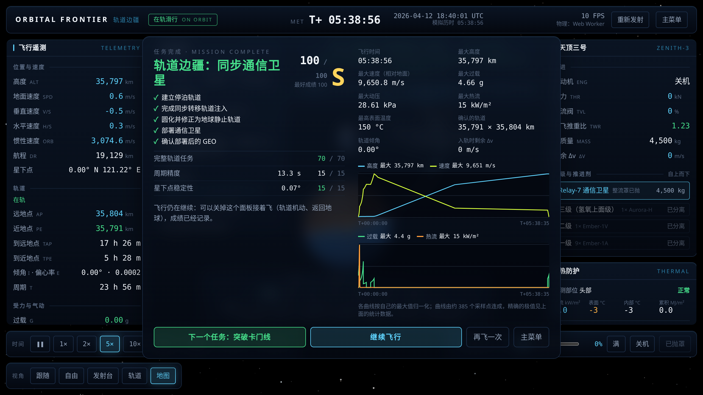

# 阶段六：高级轨道任务报告

日期：2026-11-17。分支：`feature/001`。阶段六已完成，阶段七尚未开始。

## 完成了什么

1. **解析滑行与高倍率**：安全真空区间使用开普勒传播，支持10000×和100000×。大气上界仍是1000 km；推力、手动操纵、分离体、伞与节点准备区间会阻止高速滑行或降档。物理时间仍落在0.02 s格点上。
2. **单节点机动规划**：双击轨道选点，或输入延时、顺行／径向／法向增量；显示节点、点火后的预览轨道、预计燃烧时间与剩余增量。导航球有机动标记，可保持指向机动方向。玩家负责执行点火和关机。
3. **地图**：球面及经纬网格上的未来一圈地面轨迹，正确扣除地球自转；任务目标参考轨道；新建或修改节点时自动容纳预览轨道。未限定的轨道面角度沿用当前轨道，不增加隐含的任务限制。
4. **GTO、圆化与倾角修正**：提供GTO注入、赤道交点圆化、远地点圆化、同步高度修正四类草案。赤道交点圆化把速度改变和倾角修正合为一个矢量机动。
5. **同步判定与任务**：GSO检查恒星日周期，GEO同时检查偏心率、倾角和未来一个恒星日的星下点经度摆幅。天顶三号从库鲁发射，依次确认停泊轨道、GTO、GEO、部署、部署后的GEO，各轨道目标独立保持10 s。
6. **精细操作**：上面级最低节流为100%，增加玩家主动触发的0.1 s与0.02 s短脉冲，按真实物理步消耗燃料并关机，避免用低节流指令假装能降低推力。直接分离最后一级也能被正确记录为卫星部署。

没有调整原火箭参数、4500 kg卫星质量或旧七任务的评分。新增任务对周期和经度稳定性评分，完成全部目标占70分。

## 验收

| 项目 | 当前证据 |
| --- | --- |
| 类型检查 | 通过 |
| ESLint与分层约束 | 通过；游戏层未引入React、Three或状态库 |
| 单元测试 | 43个文件、785项全部通过 |
| 生产构建 | 通过 |
| 完整物理驾驶员 | 从发射台飞到部署后的GEO；断言成功、全部目标完成且至少85分；开发基准试飞92分S |
| 浏览器测试 | 32项全部有通过记录：首轮27项通过，修复测试问题后另5项重跑通过；使用预装Playwright、SwiftShader、关闭trace |
| 截图 | deviceScaleFactor=2；机动规划、地面轨迹与任务完成截图已复核 |

物理测试覆盖霍曼转移实际传播、合并变轨矢量、非GEO的同步反例（倾斜、偏心、逆行）、太阳日与恒星日区别、地面轨迹跨日期线、GTO下降穿越大气边界、100000×主机推进与暂停、混合传播插值、短点火的连续确认、部署动量守恒、真实燃料脉冲，以及高级任务错误顺序和错误部署失败。

完整浏览器驾驶员只读取仪表和只读调试接口，通过现有按钮、键盘执行；没有注入在轨初态，没有改写位置、速度、燃料或任务状态。

完整浏览器任务取得 **100分S**（未舍入99.5546），周期误差 **13.266秒**，未来一恒星日经度摆幅 **0.06767°**，全部五个目标完成。实际GEO试飞单项耗时17.9分钟。首轮全量测试中的两项测试辅助问题修复后，相关5项在2.3分钟内通过；详细分轮结果见[TESTING](../TESTING.md)。

[原始验收数据](阶段六验收数据.json) · [机动规划截图](screenshots/阶段六机动规划.png) · [地面轨迹截图](screenshots/阶段六地面轨迹.png)

## 发现并修正的问题

- 高倍率正常降档原本会被误计为“计算跟不上”；现已区分物理限制和性能丢步。
- 两次界面采样间的短点火可能漏过轨道保持计时；物理线程现记录最后一次实际推力或分离时刻，不能借高倍率跳过重新确认。
- 跨越数千秒的线性/三次插值会把轨道画成弦线；只在整个区间均解析传播时使用开普勒插值，混合区间和分离不连续点保留保护。
- 任务多个轨道目标不能共享同一次十秒确认，后续目标也不能沿用停泊轨道的教学提示；现按各自目标推进和提示。
- 初次浏览器试飞因输入延迟和过猛转弯在约45 km整流罩过热。调整测试驾驶员的初始转弯和操纵倍率，没有放宽热或结构限值。
- 第二次浏览器试飞完成停泊轨道、GTO及赤道圆化，但远地点略高；重复圆化无法消除同步高度偏差。测试驾驶员改用同步高度修正与再次圆化，并以短脉冲精修。
- 截图复核发现机动说明挤占首屏，已把倒计时和操作按钮前置，将编辑与说明折叠；任务条只展开当前目标的读数，避免五个目标的长文本挤出界面。
- 新折叠区让测试中的summary定位器匹配多个元素；改为只定位直接子元素。旧任务测试的openApp辅助函数误切自由飞行，改由自由飞行测试自行选择；相关5项回归全部通过。
- 机动预览为瞬时脉冲，长GTO燃烧存在重力与几何损失。界面和简报明确要求核对实际远地点，必要时顺行补推，不把预览包装成精确有限燃烧解。

## 没有完成或没有验证的

- 可选的激波层辐射加热未做；没有新增GTO/GEO高速返回任务。
- 没有真人完成本阶段任务，没有真实GPU性能、Safari或触摸设备验收。软件渲染通常只有1–5 FPS，静态截图上的更高瞬时值也不代表硬件帧率。
- 高倍率下的姿态跟随仍是运动学近似，没有真实力矩或RCS耗料；短脉冲沿用无启动瞬态的发动机模型。
- 只有一个机动节点，没有多节点优化、有限燃烧轨迹优化、交会对接、自动执行机动或长期定点保持；J2、日月引力尚未建模。
- 地面平面图没有陆地底图。目标轨道是一条参考曲线，不是全部容差范围的阴影。
- 真空批次最长60 s，最大高度会补记跨越的远地点；速度等极值按批次端点采样，不保证0.02 s极值分辨率。
- 新增界面、文档和提交为中文；保留用户已提交的原七个任务英文界面。飞行曲线仍不能持久回放，日志仍为LocalStorage。

## 需要用户确认的事项

- 实际游玩后的任务难度、评分和提示反馈。
- 是否继续保持不加自动滚转；目前遵从之前的决定，没有增加。
- 是否允许任务模式更换火箭与发射场；目前固定。
- 是否收紧原火箭Δv余量；目前保持参数与旧评分，GTO/GEO任务实际使用更大的速度预算。
- 阶段六验收完成后是否进入阶段七；未确认前不会开始下一阶段。

## 下一阶段计划（尚未开始）

先根据试玩反馈确定优先级，再分步做火箭设计/更多载荷、可选的自动驾驶、存档与设置完善，以及真实设备性能和兼容性优化。复杂姿态动力学、J2等专家物理需要单独定义验收，不能把当前运动学姿态或二体轨道称为已覆盖。
